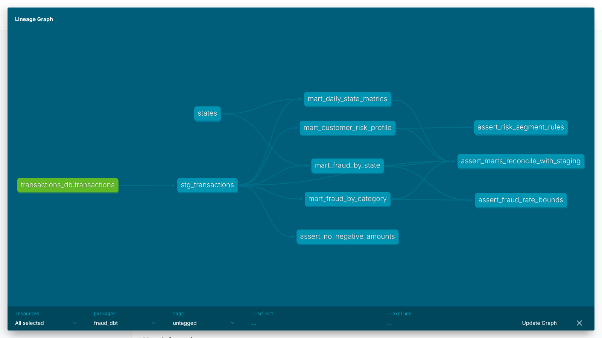

# dbt: витрины по транзакциям

dbt-проект поверх таблицы `transactions` из домашки по ClickHouse.



## Запуск

ClickHouse с данными поднимается из корня репозитория (`docker compose up -d`, затем `docker compose run --rm producer`). Дальше:

```bash
cd dbt
pip install "dbt-core~=1.10.0" "dbt-clickhouse==1.10.3"
dbt deps --profiles-dir .
dbt seed --profiles-dir .
dbt run --profiles-dir .
dbt test --profiles-dir .
dbt docs generate --profiles-dir . && dbt docs serve --profiles-dir . --port 8081
```

## Состав

- **Staging** `stg_transactions`: типы, очистка, суррогатные ключи (`dbt_utils`), календарные поля, бакет суммы (макрос `amount_bucket`).
- **Seed** `states`: штат → название, регион.
- **Marts:**
  - `mart_daily_state_metrics` — по дате и штату: число и сумма транзакций, средний чек, P95, доля крупных;
  - `mart_fraud_by_category` — fraud_rate и суммы по категориям;
  - `mart_fraud_by_state` — fraud_rate, уникальные клиенты и мерчанты по штатам;
  - `mart_customer_risk_profile` — профиль клиента и сегмент риска HIGH / MEDIUM / LOW.
- **Макросы:** `amount_bucket`, `safe_rate`.
- **Пакеты:** `dbt_utils`, `dbt_date`, `dbt_expectations`.
- **Тесты (53):** встроенные, `dbt_utils`, `dbt_expectations` и singular-тесты в `tests/`. Лог: [`docs/dbt/dbt_test.log`](../docs/dbt/dbt_test.log).
